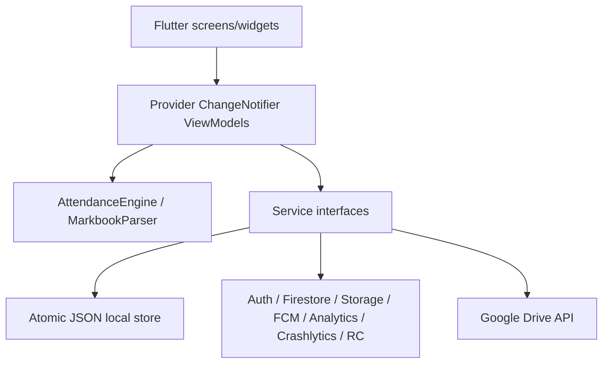
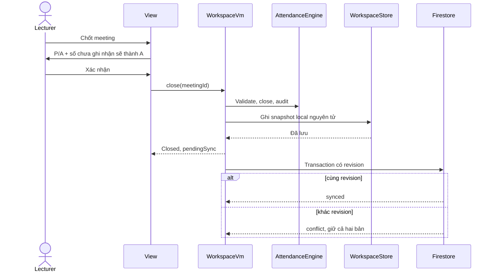

# Kiến trúc

Flutter stable 3.47.4 / Dart 3.13.3, MVVM với Provider. View không gọi SDK. Services nhận dependency qua constructor, business rules nằm trong domain service, dữ liệu biến đổi được ghi local trước khi thông báo thành công.

## Thư mục
- lib/models: kiểu dữ liệu, trạng thái màn hình, serialization.
- lib/services: luật nghiệp vụ, import/export, persistence, Firebase và Drive adapter.
- lib/viewmodels: state loading/empty/error/data, điều phối command.
- lib/screens: render state và gửi intent.
- lib/widgets: component dùng chung và semantics.
- lib/theme: màu, chữ, spacing, radius.
- firebase: security rules, default config và cấu hình triển khai.
- e2e_test: ARTEMIS Python SDK, instruction và assertion có cấu trúc.
- test: unit/widget tests; fixture tách khỏi production.
- docs, evidence, report, slides: truy vết, bằng chứng, tài liệu nộp.

| ViewModel | Services |
|---|---|
| AuthVm | AuthService, TelemetryService, WorkspaceStore |
| WorkspaceVm | WorkspaceStore, AttendanceEngine, CloudWorkspaceService, TelemetryService |
| ImportVm | FileService, MarkbookParser, WorkspaceVm |
| LinkVm | AttendanceLinkService, WorkspaceVm |
| ExportVm | ExportService, FileService, CloudFileService |
| DriveVm | DriveService, WorkspaceStore |
| ProfileVm | NotificationService, ConfigService, TelemetryService |

## Quyền và đồng bộ
Mỗi workspace thuộc Firebase UID. Firestore/Storage rules kiểm tra UID. Cache, export và thông báo phân vùng theo UID, đăng xuất xóa cache. Snapshot có revision, transaction từ chối ghi đè remote mới hơn. Không đưa email/tên sinh viên vào Analytics. Không ghi token/mật khẩu vào audit.

Local là nơi xác nhận thao tác thủ công đã lưu. Trạng thái sync riêng. Khi link đang nhận, polling Firestore nhận submissions; trước stop/close phải drain submissions và khóa link trên cloud. Offline không thể đảm bảo khóa link từ xa: giữ dữ liệu local, báo lỗi và yêu cầu mạng để kết thúc phiên link.
