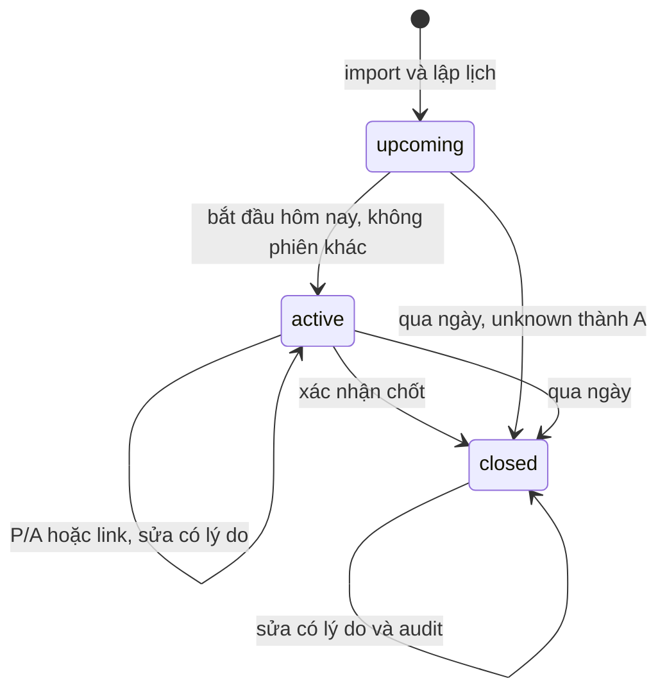

# Đặc tả workflow nghiệp vụ

## WF-01 — Tiếp nhận danh sách và lập lịch lớp
Actor: giảng viên, ứng dụng. Trigger: giảng viên nhận markbook học kỳ. Precondition: đã đăng nhập, tệp ODS/XLSX hợp lệ.
1. Giảng viên chọn nguồn và học kỳ.
2. Hệ thống đọc, kiểm tra cột/email/MSSV trùng và hiển thị preview.
3. Giảng viên xác nhận nhập.
4. Hệ thống merge roster, giữ lịch sử; bổ sung A cho sinh viên mới ở buổi đã chốt.
5. Giảng viên cấu hình 1–52 tuần, 1/2 slot, nghỉ/học bù.
6. Hệ thống chỉ lưu nếu mọi meeting còn upcoming.
Kết quả: lớp có danh sách và lịch để điểm danh. Exception: sai file → giữ form và chọn lại; hủy → không thay dữ liệu; lớp active/closed → cấm đổi lịch.
Truy vết: S01/02/03/05, MarkbookParser/AttendanceEngine, TC03–05.

## WF-02 — Ghi nhận và chốt buổi học
Actor: giảng viên, sinh viên, ứng dụng, Firebase. Trigger: buổi học hôm nay cần ghi nhận. Precondition: roster tồn tại, không có meeting khác active.
1. Giảng viên bắt đầu meeting hôm nay.
2. Hệ thống mở một phiên; giảng viên chọn link hoặc thủ công.
3. Sinh viên xác thực và xác nhận qua link trong hai phút, hoặc giảng viên chọn P/A.
4. Hệ thống ghi nhận duy nhất; link không ghi đè kết quả có sẵn.
5. Giảng viên xem thống kê và xác nhận chốt.
6. Hệ thống ngừng link, giữ P/A, chuyển unknown → A, khóa ghi trực tiếp.
Kết quả: roster một meeting đủ P/A có thể xuất. Exception: offline → manual; duplicate → không tăng số lượng; hủy chốt → giữ active; link hết lượt → mở lượt mới; sai email → từ chối.
Truy vết: S02/04/06, AttendanceEngine/AttendanceLinkService, TC06–10.

## WF-03 — Điều chỉnh và bàn giao kết quả
Actor: giảng viên, ứng dụng, Cloud Storage/Drive. Trigger: phát hiện sai kết quả hoặc cần bàn giao. Precondition: meeting active/closed; xuất cần closed đủ P/A.
1. Giảng viên xem lịch sử lớp và sinh viên.
2. Giảng viên chọn P/A mới và nhập lý do mới.
3. Hệ thống lưu trước/sau, lý do, thời điểm và cập nhật tổng.
4. Giảng viên chọn JSON/CSV cho đúng lớp/meeting.
5. Hệ thống lưu file local, có tùy chọn upload per-user/Drive.
6. Hệ thống trả vị trí lưu, tiến độ, URL hoặc lỗi retry.
Kết quả: kết quả có audit và tệp bàn giao. Exception: lý do trắng → giữ form; hủy → không sửa; sync conflict → giữ hai bản; lỗi cloud → giữ file local.
Truy vết: S07/08/09/10, ExportService/DriveService, TC11–15.

